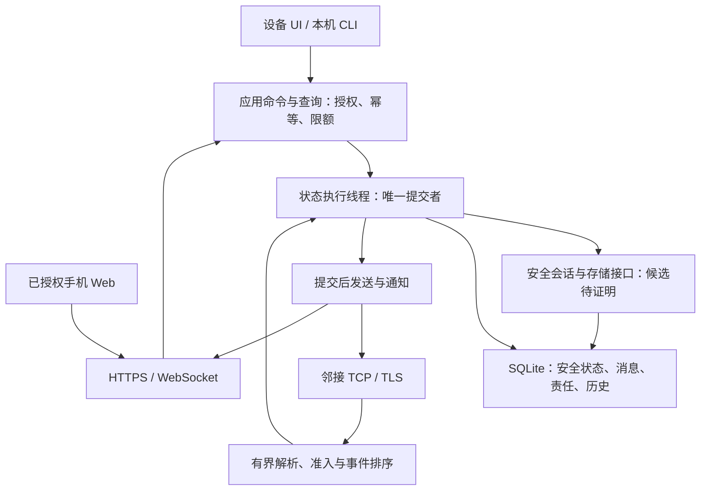

# Node 服务架构与关键选型方案

- 状态：D1—D5 已于 2026-10-24 获所有者接受；对应 ADR 0004，其他具体机制仍按专题评审
- 更新日期：2026-10-24
- 目标读者：所有者、Node 实现、安全与验证协作者
- 范围：首期一对一文字、Node 身份与历史、设备独立入口、本地 Web、Linux ARM64 有线台架接入
- 非目标：本轮实现服务、冻结密码构造或无线器件、修改既有实验合同、采购和部署

## 推荐结论与适用范围

采用已接受的 **Rust 单进程 Node 服务 + 串行状态提交 + SQLite 单库事务**，部署方向为 Linux ARM64。网络与界面使用异步 I/O；安全会话和消息状态由同一个状态执行线程管理。Node 持有身份、会话与历史，本机界面和手机都调用同一应用入口。Go 保留为已有验证工具的语言。

选择依据是事务和维护边界，而不是预先宣称 Rust 比 Go 更快或更省电。当前密码优先候选为 Rust 的 mls-rs；让服务与候选在同一语言、进程及事务协调边界内，可以减少 FFI、IPC 和双重持久化的失败组合。语言选择并不接受 mls-rs，也不证明其联合事务能力。

本方案承接已接受的[消息交付语义](../protocol/message-delivery-semantics.md)、[系统分层](system-architecture.md)及 Node 身份职责；[文字通信事务设计](minimal-text-slice.md)中的 T-A/T-B/T-C/T-D、安全 proof 和 SW-G3 修订仍按原状态评审。本文细化服务工程方案，不复制测试协议为产品协议。

所有者已明确接受 D1—D5，并要求提交方案和 ADR 后推进第一批开发。接受范围记录在 [ADR 0004](../adr/0004-node-service-foundation.md)；本文件的其他候选参数和未证明安全机制不随之自动生效，外部操作边界不变。

## 现有实现与复用判断

| 已核对对象 | 可复用价值 | 产品化处理 |
| --- | --- | --- |
| `tools/t0/internal/delivery/retry.go`、`limits.go` | 重试优先级、额度、截止点、长度与溢出拒绝规则 | 以规范和已有测试向量为依据移植到 Rust；逐项比较，不在产品中启动 Go 子进程 |
| `tools/t0/internal/synthetic/node.go` | 动作绑定、消息事实、数据/证据责任的参考实现 | 包含固定 A/B/C、测试时钟及 `VerdictSource`；不直接搬入服务，也不保留可默认接受认证的产品开关 |
| `tools/t0/internal/synthetic/store.go` | 写失败、提交不确定、恢复拒绝等故障经验 | JSON 快照、测试恢复监督者不是产品数据库或可信时钟；保留历史实现作为验证参考 |
| I4/I5 profile、validator 与 evidence | 故障分类、预期/禁止结果、证据消费经验 | 原 schema、profile 和历史证据不改；服务测试记录独立版本，后续需要正式接入时显式映射 |
| `tools/spikes/sw-g2-mls-rs/` | 固定候选和依赖基线 | `main.rs` 仍以退出码 2 拒绝 Phase B；不修改或把它包装成产品加密组件 |

方案提出时仓库没有正式 Node 服务。首批已在 `node/` 建立一个 Cargo package，包含库模块、`radishlink-node` 与 `radishlinkctl` 入口；当前只有离线服务/事务基础，生产入口拒绝运行，详见[实施记录](../testing/node-service-foundation.md)。不预建多个空 crate 或插件系统。现有 `tools/` 保留验证职责。模块真正需要跨进程或被原生客户端复用时再拆分。

## 关键选型比较

| 决策 | 推荐 | 主要备选与取舍 |
| --- | --- | --- |
| 服务语言 | Rust，项目代码默认禁止 `unsafe`；第三方 native 库另行审计 | Go 可直接复用部分算法，但与当前 Rust 安全候选结合需要 FFI 或独立服务；C/C++ 增加内存安全审查负担。Rust 的代价是迁移算法、编译与依赖维护成本 |
| 进程结构 | 模块化单进程；网络异步、状态串行；CLI/设备 UI 不直接读数据库 | 分拆消息/密码/存储 daemon 会引入分布式提交与更多恢复协议，首期收益不足；单进程故障会影响整个 Node，靠持久恢复和进程监督处理 |
| 存储 | 一个 SQLite 数据库、一条受控写连接，显式 SQL 与迁移；Rust binding 优先评估 rusqlite | JSON 全量快照的放大写入与演进成本不适合继续沿用；嵌入式 KV 需自行维护更多索引和关联不变量；独立数据库服务增加部署开销 |
| SQLite 日志 | 首期 `journal_mode=DELETE`、`synchronous=EXTRA`，启动读回检查 | WAL + FULL 是可选演进方向，但需管理 checkpoint、长读者及 WAL 容量。首期短文字和串行访问优先降低协调复杂度，不把性能假设当实测 |
| I/O 与本地 API | Tokio；HTTP 路由候选 Axum；JSON 请求/响应与 WebSocket 状态通知 | 标准库适合纯算法，但手写 HTTP/TLS 不合适；不引入 gRPC、消息 broker 或独立 Web 后端 |
| 节点传输 | 有线阶段 TCP + TLS 1.3 双向邻居认证；TLS 实现候选 rustls | QUIC/UDP 留给移动链路和媒体证据驱动的选择；TCP 成功写入不产生 custody 或 delivery。邻居 TLS 不替代消息 E2EE |
| 产品信封编码 | 候选为有界长度前缀 + 版本化 CBOR；密码载荷保持库输出的原始字节 | JSON 保留给本地 API 和诊断。CBOR 的字段分配、确定性子集和认证绑定须随 SW-G2/协议评审完成，不在本轮冻结字节格式 |
| Linux 交付 | ARM64 GNU target、普通非 root 服务、systemd 监督；macOS 用于离线开发 | 不把容器作为实体设备的运行依赖，不从开发机可编译推导 ARM64 可运行；不新增 UTM 或修改 I5 环境 |

SQLite 官方说明 EXTRA 在 DELETE 模式额外同步 journal 删除后的目录；这是选择依据，实际耐久性仍依赖 VFS、文件系统、卡及供电行为。[SQLite PRAGMA](https://sqlite.org/pragma.html#pragma_synchronous)。WAL 的单写者、checkpoint 和附加文件要求见[官方 WAL 文档](https://sqlite.org/wal.html)。

Rust 官方列出 `aarch64-unknown-linux-gnu` 目标；这只支持目标选择，不能证明 AWS-LC、SQLite native 构建或当前 BSP 已兼容。[目标说明](https://doc.rust-lang.org/rustc/platform-support/aarch64-unknown-linux-gnu.html)。Tokio 的有界 channel 可承载背压，但总任务数与等待者仍需应用限制。[channel 说明](https://tokio.rs/tokio/tutorial/channels)。

## 模块与执行模型

| 模块职责 | 所有权与边界 |
| --- | --- |
| 应用入口 | 授权检查、动作引用、联系人选择、消息查询；不知道物理网卡和数据库表 |
| 消息状态机 | 消息事实、数据责任、证据责任、deadline/hop 与配额；不自行构造密码学证明 |
| 安全会话 | 身份、会话、认证、加解密和安全状态变更；只在获准的持久化上下文操作，不私自另开数据库提交 |
| 存储 | 唯一连接、事务、schema、迁移、恢复、空间账本；不发送网络包，不直接驱动 UI |
| 邻接与路由 | 已验证邻居、路径策略、连接事件、字节读写；首期固定配置 A—B—C，避免 IP 转发绕过 B 应用中继 |
| 生命周期与观测 | 配置、启动、健康、停止、脱敏指标；不向日志输出正文、长期身份或秘密 |

执行规则：

1. 网络任务仅持有有界 frame 和连接状态；先限制连接数、长度、解析深度、握手时间及来源速率。队列满时背压或明确拒绝，不无限创建等待任务。
2. 一个专用线程拥有可变消息状态、活动安全会话和 SQLite 写连接。同步数据库/密码调用不阻塞 Tokio I/O 线程；一次只处理一个可变状态事件，不在事务中等待网络或用户输入。
3. 接收队列、控制队列和查询均有额度及公平调度。被认证的控制事件可优先，但不能让未认证流量伪装成控制流，也不能让历史查询无限阻塞截止事件。
4. 状态线程给事件分配递增序号，形成明确批次截点；同批次执行 stop、pause、普通发送的优先级。已截断批次后的包进入下一批，不使用对端时间或线程到达竞态重写过去。
5. 事务提交后才发布通知或发送许可。发送许可一次消费、绑定消息/责任/提交代数；真正写出前重新检查终态、deadline 和剩余额度。崩溃或写失败不退还已消费预算。
6. API 查询同样经状态线程分页读取；首期不建立第二个数据库写入者。WebSocket 只是变更提示，丢提示后重新查询已提交状态，不靠内存广播证明用户交付。
7. 纯算法只依赖显式时间与事件输入；线程、socket、随机源和真实时钟留在边界。测试替身仅在测试目标中编译，产品没有“禁用认证后继续发送”的模式。

## 数据模型与联合事务

下表是逻辑记录建议，SQL 名称与 migration 1 在实施批次内定稿；所有关联数据进入同一数据库，不通过 `ATTACH` 或另一个 provider 数据库制造表面统一。

| 记录 | 唯一性 / 约束 | 内容与生命周期 |
| --- | --- | --- |
| Node 与联系人 | 本机身份代数、联系人端点引用 | 身份引用、信任状态、撤销观察与别名；IP/MAC 不是身份 |
| 安全会话与材料 | 会话/epoch/库定义键 | 库需要的持久状态与已消费材料；精确字段由适配证明决定 |
| 消息及密文 | SW-G1 message key 唯一，核心不可变 | 认证核心、密文、来源/目标、消息事实；conflict 不覆盖原记录 |
| 传输责任 | 消息 + 邻接 + 责任类型 | 数据和证据分开，保存 hop 副本、重试消费、截止点与返回责任 |
| 用户动作 | Node + 授权主体 + action reference 唯一 | 绑定请求内容和结果；同引用不同内容拒绝，同内容返回原提交结果 |
| 用户历史 | 本机端点 + 消息引用唯一 | 可展示内容与发送/接收事实；不随传输副本清理而消失，中继不建正文历史 |
| 去重与终态 | message key + 原始认证引用 | tombstone、保留边界及终态；容量压力不能提前删除 |
| schema / 提交元数据 | 单调提交代数、显式版本 | 迁移、提交结果查询与恢复校验；数据库内代数不充当抗整盘回滚的可信计数 |

**提交顺序选择：同一数据库、同一事务、一个提交者。** T-A 同时保存安全发送状态、动作绑定、消息与 outbox；T-B 保存中继 payload、去重和责任后才 custody；T-C 保存接收安全状态、历史、去重、证据及回程责任后才展示/确认；T-D 保存验证终态、tombstone 和尚需转发的证据责任后才回收 payload。详细不变量以[事务表](minimal-text-slice.md#从动作到恢复的事务表)为准。

目前公开的 `mls-rs-provider-sqlite 0.23.0` API 提供 group、KeyPackage、PSK 与 application storage；这些接口名称不足以证明与上述业务写入共同提交。[固定版本 API](https://docs.rs/mls-rs-provider-sqlite/0.23.0/mls_rs_provider_sqlite/struct.SqLiteDataStorageEngine.html)。本轮未完成其固定源码实现审计，也未运行适配。

接入前必须证明：库全部持久写入能由同一外部事务控制；包含 KeyPackage 消费、epoch/skipped-key 更新等旁路；调用失败后的内存会话能丢弃并从已提交状态重建；没有提前输出网络效果。如果现有 provider 不具备能力，优先评审使用库正式 storage trait 的事务适配，而不是改密码算法、fork 候选或用第二套提交日志补偿。该适配是待评审新范围，不能改动现有 spike 的 provider/feature/lockfile 来尝试绕过停止线。

一旦 COMMIT 返回结果不确定，停止相关状态的发送、展示和新安全操作，关闭不可信内存会话，通过数据库恢复后的提交代数及动作绑定判断结果；无法判断时保持 `QUARANTINED`，不自动重发、不创建空库。事务回滚也要丢弃可能已推进的内存安全对象，不能只回滚 SQL 后继续使用它。

## 生命周期、时间与恢复

服务对外报告 `UNINITIALIZED`、`LOCKED`、`RECOVERING`、`READY`、`DEGRADED`、`QUARANTINED`、`STOPPING`，并分别给出“可查询 / 可提交 / 可转发”能力。离线无路由属于可排队的 `DEGRADED`；损坏、密钥不可用和提交不确定不能混成普通离线。

- **初始化**：显式本机操作创建身份与数据，不因库文件缺失而自动初始化；已有身份却缺库时拒绝。Node 生成身份使用成熟库及 OS 随机源；标签、MAC 和固定配置不能提供私钥。
- **启动**：检查配置/schema、目录权限、单实例锁、加密卷和数据库恢复结果；确认所需 journal/同步配置实际生效；再恢复责任与安全对象。恢复完成前不接受业务连接，不宣告 ready。
- **时间**：进程存活期使用单调时钟；持久保存保守寿命信息与启动标识。重启后若缺少可信的停机时长上界，不自动续传旧消息，而是隔离旧责任并保留去重/历史，直到可靠时间依据建立或按显式规则终结。普通 NTP、邻居自报时间和磁盘上的 boot counter 都不能独自提供可信上界。测试监督者的时钟不进入产品。
- **正常停止**：停止新提交，完成或回滚当前事务，撤回未执行发送许可，关闭连接、数据库与敏感内存；达到停止期限时由监督器结束进程，下一次按崩溃恢复处理，不能报告未完成写入成功。
- **监督**：候选为 systemd readiness 与限次数失败重启；配置、schema、密钥及隔离错误停止自动重启，避免无限重启破坏诊断。[systemd 官方说明](https://freedesktop.org/software/systemd/man/latest/systemd.service.html)。

缺少可靠 RTC/时间恢复和防回滚基座是实体台架必须回答的问题，不能把“重启后数据库能打开”当作消息可安全续传。

## 本地数据保护与用户行为

推荐首期 Linux 数据目录位于 **LUKS2 加密数据卷**，由平台启动流程解锁；Node 进程保持非 root，不负责格式化或打开任意块设备。数据库、journal、身份材料和临时敏感文件均须处于保护边界内；禁用明文 core dump，swap/休眠策略随整机部署评审。已有安全架构要求的验证启动、防回滚和签名更新仍独立成立。

选择加密卷是为了覆盖数据库旁路文件，避免先自研字段加密、密钥包装和 nonce 管理。SQLCipher 可作为后续比较对象，本轮不切换现有 `sqlite-bundled` feature。Linux dm-crypt 提供块设备加密，cryptsetup 提供 LUKS 管理；这些能力不自动证明设备已有可信启动或抗回滚。[Linux dm-crypt](https://www.kernel.org/doc/html/latest/admin-guide/device-mapper/dm-crypt.html)、[Debian cryptsetup 手册](https://manpages.debian.org/bookworm/cryptsetup-bin/cryptsetup.8.en.html)。

所有者已接受的行为（D3/D5）：

- 冷启动由用户在设备本机解锁一次；手机离开不锁定 Node，已解锁 Node 继续工作。裸板阶段可用受控本机控制台验证，不能把 SSH/手机写成最终必需入口。
- 明确区分“关闭显示/断开手机”和“锁定设备”。前者可继续收发，界面清除可见内容；后者停止端点与中继服务、清除可销毁秘密并由平台关闭卷。关闭失败必须显示未锁定，不能只显示锁图标。
- 第一阶段不提供把解锁密钥与加密数据一起放在卡上的自动解锁。固定中继无人值守重启若成为刚需，另选可信硬件密钥方案；当前板卡能力未证明。
- 建议历史默认保留 7 天，达到配置容量时提示清理，不静默提前删除未到期历史；删除历史不改变网络去重、证据责任或联系人身份。自动到期删除属于已接受的用户数据策略，须有可靠时间与测试覆盖；不承诺闪存物理擦除。
- 暂不提供可恢复活动安全会话的普通备份导入。SQLite 和卷加密都不能检测完整旧镜像替换；真实数据启用前必须证明独立防回滚机制或经安全评审的重新建立会话流程。不能让用户点击“继续”恢复可能回退的密码状态。

所有者已接受默认 7 天保留。到期时钟不确定时保持历史并明确提示；容量不足时显式拒绝需要历史空间的新操作，不得删除 tombstone 腾空间。修改默认保留行为需作为用户数据策略变更说明。

## 应用接口与本地 Web 信任

应用层操作建议为 `SubmitText`、`GetAction`、`GetMessage`、`ListHistory`、`ListContacts`、`GetNodeStatus` 和界面授权管理。本机 Unix socket 以文件权限与对端凭据限制访问；HTTP 层只把这些操作映射为版本化 `/api/v1` 资源，不拥有第二套消息逻辑。普通 UI 不获得迁移、原始 SQL、密钥导出或系统命令能力。

`SubmitText` 的 action reference 是界面操作幂等键，不是安全消息 ID。超时后先查询同一动作，不凭 HTTP 错误推导事务未提交；同键不同内容返回 conflict。动作保留窗口届满后返回明确过期，不把旧键当新操作；撤销或丢失界面授权也不自动再发。实现需在有效授权主体内保留足够的去重记录，并让旧授权主体的键永不跨入新授权空间。

为使有限保留可实现，建议动作键包含服务分配的操作代数和客户端引用：现役代数的绑定不单独提前清除，容量达到上限时停止接纳新动作；代数退休后以持久水位拒绝全部旧键，再按保留规则清理绑定。操作代数分配、退休和对应提交必须受同一事务约束，授权刷新不自动重建用户动作。旧动作查询可返回已退休，界面转为查询消息历史，不自动换键补发。该代数只解决本地幂等资源回收，不提供密码学防回滚保证。

用户状态保持“已排队”“中继已接收，等待送达”“已送达”“到期/失败”；页面打开不自动发送已读。查询使用有界游标，WebSocket 断线后重取快照；游标过期显式重置，不能静默漏消息。响应错误包含稳定原因码、可查询引用及重试建议，不回显正文、密钥或数据库内部错误。

本地 Web 沿用已选择的 HTTPS/WebSocket 方向，但“扫描二维码”不能绕过浏览器证书验证。推荐 P0 使用**所有者受控的开发 CA，在指定测试手机/Mac 上显式安装信任**；CA 私钥留在受控签发端，不随 Node 镜像、二维码或网页分发。每 Node 单独服务器证书与主机名，邻居和界面授权再分别绑定 Node 身份，禁止通用共享客户端凭据。

安装 CA 扩大测试终端的信任范围，需要单独系统操作授权；先验证各系统的证书链、名称、有效期、本地名称解析和离线时间行为，再开放入口。域名约束若不能被目标平台可靠执行，不能宣称 CA 只影响单个站点。iOS 手动安装根证书后还需要显式启用 SSL 信任。[Apple 官方说明](https://support.apple.com/en-la/102390)。这是一项 P0 开发取舍，不承诺普通用户免设置即用。

在 TLS 可信后，设备物理确认开启短时一次性配对，生成独立界面授权；浏览器使用受限会话、同源访问、Secure/HttpOnly/SameSite cookie、CSRF/Origin 检查及撤销机制。秘密不进 URL、localStorage、日志或分析服务，页面禁止缓存敏感正文和第三方脚本。手机丢失时可在 Node 撤销授权；撤销关闭已有 WebSocket 并拒绝后续查询。精确授权机制仍须安全评审，不以 cookie 属性替代完整认证设计。

若所有者不接受测试设备安装 CA，推荐先保留本机 UI，重新评审把可固定设备证书的原生伴侣提前；不采用长期忽略证书错误或 HTTP 明文替代。

## 邻接、线格式与资源规划

有线台架固定邻居和路径；B 的两个接口分别连接 A/C，数据必须经过 B 的消息服务。服务不修改内核路由、网卡地址、防火墙或开启 IP forwarding；这些由独立部署操作包准备。邻居不可达时按已持久化责任等待，只有唯一 B 时不宣称具有替代路径恢复。

TLS 1.3 的双向认证只确认当前邻居；目标身份、消息不可变核心、E2EE receipt 与 relay-clear proof 仍由 SW-G2 证明。推荐关闭 0-RTT，明确握手/证书轮换/撤销策略；IP 变更不改变身份，身份变更不能自动覆盖。rustls 支持 TLS 1.3，并有独立密码 provider 选择，最终依赖图须重新审查，不能直接继承旧 spike 许可结论。[rustls 官方 API](https://docs.rs/rustls/0.23.46/rustls/)。

候选 wire profile 使用长度前缀在分配前拒绝超长 frame；CBOR 限定深度、项数与整数范围，拒绝重复键、未知 critical 字段和不允许的编码形式，认证相关原始字节保持不变。未知可忽略扩展只在可保留原字节且符合 SW-G1 时转发。CBOR 的确定性编码规则来自 [RFC 8949](https://www.rfc-editor.org/rfc/rfc8949.html#section-4.2)，不是新的密码构造；密码库自己的编码不重写为 CBOR。字节布局及认证绑定未定稿前不发布产品网络互通声明。

以下为实施容量测试的**起始建议**，不是已接受的正式 profile、性能承诺或运行预算：

| 项目 | 建议起点 | 调整依据 |
| --- | --- | --- |
| 单条 UTF-8 正文 | 4 KiB，编码后检查 | 高于常用 20–100 汉字短文；密码额外开销单独计量 |
| 单个节点 frame | 64 KiB，完整长度、深度与项数均受限 | 仅文字阶段；不足时拒绝并评审，不隐式切片或扩大 |
| 待发/中继 payload | 全局 2048 条且 16 MiB，任一先到即限制；另按来源/邻居划分 | 5 人 × 30 条/小时 × 8 小时 = 1200 次发送动作的规划量级，不是每节点实际负荷证明 |
| 历史 | 最多 10000 条且正文 64 MiB；建议 7 天到期 | 足够覆盖规划活动量，索引和密钥另计；满额不悄悄删除未到期历史 |
| 查询 | 每页最多 100 条，单响应字节另限 | 禁止一次读取全部历史或无限订阅缓存 |
| 资源账本 | payload、控制、tombstone、安全状态、journal、索引、迁移临时副本与日志分别核算 | SQLite 文件大小不等于全部磁盘占用；`journal_size_limit` 不能充当进行中事务的硬额度 |

发送数量不是磁盘上限证明。schema、密码状态大小及维护动作确定后，必须在第一批存储实施中给出各项明确上限、写前预留和满额拒绝测试；控制/去重空间未能预留时不接受 custody 或 endpoint delivery。量测前不承诺常驻内存、耗电或吞吐。以上产品容量提案与 I5 的 768 MiB 全批运行额度没有替代关系。

## 版本、迁移、构建与部署

- 本地 API、产品 wire、安全库状态、数据库 schema 和验证 evidence 分别版本化，不能用单一软件版本替代。未知主版本拒绝，未知持久状态不自动建空库；兼容范围写入构建 manifest。
- 数据库演进采用显式顺序 migration、来源版本校验和事务内转换；需要重建的大迁移在维护模式单独预留双份空间。软件回退只有在旧程序明确支持当前 schema 时允许；禁止自动恢复旧密码库快照来配合软件降级。
- 建议普通配置使用严格的版本化 JSON：复用本地 API 的解析依赖，未知键、重复关键键及无效路径拒绝。秘密不放配置、环境变量或命令参数，只通过受控文件/描述符与平台解锁流程提供。影响身份、存储、认证和监听面的配置修改需要停止并重新校验，首期不做任意热更新。
- 建议部署目录为只读程序、只读配置、受保护状态目录和 `/run` 临时 socket 四类；具体安装路径由未来包格式决定。本机 CLI 也经服务读取状态，不绕过单写者开库。
- 构建固定 Rust toolchain、target、Cargo.lock、native C 工具链和构建 flags；产物记录源码 revision、锁摘要、SQLite/native 版本、features、许可证清单和兼容范围。GNU ARM64 构建需验证目标 glibc/BSP，不以 macOS 构建或模拟器测试替代。
- 第一阶段不安装 systemd unit、不开放端口、不更改分区或驱动；部署、加密卷创建、CA 安装、实体启动和断电试验各自属于需精确授权的外部操作。签名更新与整机 A/B 回滚沿用安全专题，不能用普通覆盖二进制冒充完成。

## 依赖引入边界

| 依赖方向 | 本次依据 | 实施前要求 |
| --- | --- | --- |
| Rust 标准库 | 纯算法、错误、同步和基础类型优先使用 | 固定 toolchain；不用 nightly 作为默认 |
| Tokio / Axum / rustls | 官方能力与上述执行/API/传输方案相符 | 冻结精确版本、features、native provider 和完整图；审查许可、维护与 advisory，先不安装 |
| rusqlite / SQLite | 现有候选 lock 已含 rusqlite 0.37.0、libsqlite3-sys 0.35.0 | 仅作为兼容比较基线，非批准在新产品直接沿用旧版；确定 bundled SQLite 版本、编译选项及更新责任 |
| serde / JSON、CBOR 实现 | JSON 方向已有候选使用；CBOR 有标准依据 | 复用可用版本；CBOR parser 要有拒绝重复键/深度限制能力，选包前不预设成熟度结论 |
| mls-rs / provider | 现有固定图与 SW-G2 决策包 | 维持原 STOP；任何新 storage 适配、功能构建或 feature 变化均先说明差量并评审 |
| cryptsetup / 平台服务 | Linux 本地数据保护与生命周期方向 | 核对 BSP 包版本、许可证、内核能力与实际部署资源；不自动安装或格式化 |

不引入 ORM、独立数据库服务器、消息中间件或自动更新器。上述第三方路线未经过本轮完整供应链审计；依赖精确版本会在获准实施前集中列清，不把动态 `latest` 文档当成版本锁。Axum 的 Tokio/Hyper 关系见[官方 API](https://docs.rs/axum/0.8.9/axum/)。

## 实施节奏与验收

| 批次 | 连贯交付 | 完成标准与限制 |
| --- | --- | --- |
| 1. 服务与事务基础 | `node/` 工程、配置/错误/生命周期、纯消息模型与调度、SQLite schema/事务/恢复、应用命令和查询、离线故障测试 | 精确依赖和范围获准后实施；生产入口在安全缺失时明确拒绝业务发送。测试替身只用于单元测试，不制造可用聊天演示 |
| 2. 安全会话与持久状态接入 | 首次信任、发送/接收联合提交、证据验证、撤销与恢复映射 | 先满足许可证/R2 和候选功能试验前置；证明 storage trait 能力、每个故障点及 proof；不适配就报告并重评，不用补偿式双写掩盖 |
| 3. 本机与手机入口、有线传输 | 同一应用入口的设备控制/API、可信 HTTPS、界面撤销、邻居 TLS、路由与背压 | 先离线解析/授权/幂等验收，再按新的精确环境合同接入；不重开旧 I5 入口或复用其运行授权 |
| 4. ARM64 三节点验证 | 构建部署记录、A—B—C 文字、断链、回执丢失、重启/掉电、容量及设备独立操作 | HW 与安全门满足后才实测；分别记录软件离线、Linux 进程、有线实体和物理掉电证据，不互相替代 |

首批不是只生成骨架：应交付可测试的消息与事务行为，同时明确“尚不能进行真实安全通信”。安全等待期间可以完成独立的数据层和接口拒绝路径；不能为了展示效果把测试替身编入服务。

必要测试矩阵包括：T-A/B/C/D 的提交前、中、后而通知前故障；commit 结果不确定；满盘/只读/损坏；同动作重复与异内容冲突；重复消息与证据返回责任；时间回拨和未知停机时长；限额与慢客户端；未知版本/迁移中断/降级拒绝；授权撤销/身份变化；日志和错误不泄露秘密。Rust 调度对已有规则做差分验证，但 Go 输出不是唯一正确性来源，仍须独立检查 SW-G1 不变量。

方案接受、代码单测、密码适配、实体实测分别记录结论；本轮不把设计自审称为独立安全复核。每批完成代码、测试、文档和遗留项后交接，按可审阅主题提交需另有提交授权，不按辅助脚本数量衡量进度。

## 集中确认清单

以下五项已由所有者于 2026-10-24 在本次会话全部接受，形成 ADR 0004。表格保留决定与影响，作为实施追溯依据。

| 编号 | 已接受的决定 | 实际影响 |
| --- | --- | --- |
| D1 | 产品 Node 采用 Rust，已有 Go 保留验证职责 | 接受算法移植与测试迁移成本，换取与 Rust 安全候选更直接的集成；候选被否决时重评集成，不自动改语言 |
| D2 | 单进程、一个状态提交者、SQLite 单库事务 | 首期 DELETE + EXTRA；同一服务故障会影响整节点，依靠可靠恢复；不能实现安全联合提交时暂停适配，不降为双库补偿 |
| D3 | Linux 加密数据卷、冷启动手动解锁，完全锁定时暂停中继 | 手机离开不影响已解锁 Node；暂不承诺无人值守冷启动恢复。只接受设计方向，不授权格式化、安装或处理真实数据 |
| D4 | P0 本地 Web 使用受控开发 CA，后续验证指定测试设备 | 测试手机/Mac 需要显式安装信任并在测试结束后撤销；若不接受，则调整为本机入口优先并另评原生伴侣，不绕过证书错误 |
| D5 | 历史默认 7 天到期、容量不足时显式提示 | 到期会删除用户可见历史；未来修改保留行为须明确说明。网络去重/证据保留独立，不能随历史一起删除 |

所有者已授权在方案和 ADR 提交后推进第一批服务与事务基础开发；实施范围与依赖差量另行记录。D3/D4 的实际平台操作留在后续部署批次；本次不授权依赖安装、候选 Phase B、采购、系统修改、网络实验或远程写入。

仍需工程/专业证据、不能由所有者一句确认代替的事项：安全库联合事务与 relay-clear proof、许可证/R2、可信时间与抗旧镜像回滚、SQLite 物理掉电行为、各平台 HTTPS 首次信任及 ARM64 实测。这些事项已有明确归属和进入条件，不新增一套平行 gate。
