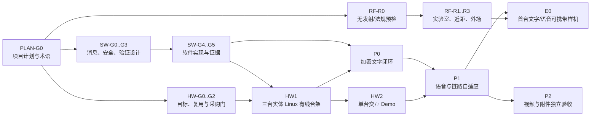

# RadishLink 项目执行计划

- 状态：Accepted（`PLAN-G0`，2026-08-24）；2026-09-26 确认视频顺序，2026-10-09 细化场景、预算、端点职责与评审方向；专题安全/验证设计仍待评审
- 更新日期：2026-10-28
- 适用范围：D0 至 E0 的产品成熟度、软件、硬件与射频证据依赖
- 目标读者：产品、架构、安全、软件、硬件、法规与测试协作者

## 目的

本文是项目级执行入口，用来回答“当前在哪个阶段、下一步先设计什么、什么证据允许进入下一阶段”。它不取代产品定义、专题设计、ADR 或测试规范，而是约束它们的顺序和依赖。

项目不再用一个编号同时表示产品阶段、软件实验、硬件样机和射频测试。所有成果必须同时标明产品成熟度和证据轨，避免把局部探针写成项目完成。

## PLAN-G0 评审记录

- 结论：Accepted；
- 日期：2026-08-24；
- 接受范围：`D0/P0/P1/P2/E0` 产品成熟度、`SW/HW/RF/EXP` 证据轨、总体依赖、阶段进入关系和计划停止线；
- 直接结果：允许分别进入 `SW-G1..G3`、`HW-G0/HW-G1` 和 `RF-R0` 的设计或只读核对；
- 授权边界：本 gate 不授权实现、依赖安装、容器或虚拟机运行、采购、刷写、设备启动、射频发射或远程状态修改。

## 命名体系

### 产品成熟度

产品成熟度保留以下编号；2026-09-26 起 P2 不再是首台 E0 文字/语音样机的顺序前置：

- `D0`：定义、法规预检与方案设计；
- `P0`：加密文字三节点闭环；
- `P1`：实时语音与链路自适应；
- `P2`：受限视频与附件；
- `E0`：可携带工程样机。

只有[路线图](../roadmap.md)的进入与退出条件全部满足，产品成熟度才推进。

### 证据轨

- `SW-*`：消息语义、E2EE、持久化、故障注入和软件模拟；
- `HW-*`：实体 Linux 节点、交互/电源辅助 MCU、接口、启动、存储、资源与物理恢复；
- `RF-*`：地区法规、SKU、监管域、射频台架、距离和携带状态；
- `EXP-*`：在计划前或阶段外执行的探索性探针，只能作为需求输入。

示例：2026-08-20 的 Docker 运行记为 `SW-EXP-001`，不称为 `E0`、`P0 PASS` 或已完成 `SW-V0`。

## 当前项目位置

产品仍处于 D0；软件计划、消息语义、确定性验证设计与 `SW-V0` 已有相应接受/运行记录，E2EE 决策、实体台架和无线地区前提仍未关闭。各候选及许可证的最新状态统一见[当前状态](current.md)，本计划不复制 run/hash 流水。

截至 2026-09-05，mls-rs D2 已通过固定图 Phase A，R1c-R 与 R1d-L 分别形成许可证证据与处置 `STOP`，debug_tree 澄清 helper 已离线实施，R2 与 Phase B 仍被阻断；不能继续使用“R1 尚未执行”的旧状态。

### 2026-09-26 范围决定与本轮产物

所有者确认熟人小队预先配对的首期场景、中国上海测试/使用地区、整套人民币 2000 元预算，以及视频不阻挡首台文字/语音样机。具体输入见[产品定义](../product-definition.md#首期范围决定2026-09-26)，阶段影响见[路线图](../roadmap.md#阶段顺序修订记录2026-09-26)。本次只调整已说明的产品范围和阶段依赖，不接受尚未评审的 SW-G2/SW-G3 修订，不授权采购或外部运行。

本轮形成[SW-G3 修订评审包](../testing/sw-g3-revision-2-review.md)和[最小文字闭环设计](../architecture/minimal-text-slice.md)，均为 Draft；许可证按渠道的具体待填输入收敛到[SW-G2 评审输入](../security/e2ee-sw-g2-decision-package.md#2026-09-26-许可证评审输入与责任)。当前阶段仍为 D0。

### 2026-10-09 接续决定

所有者将整套预算调整为目标 2000–3000 元、累计硬上限 3000 元，并接受 3–5 人熟人小队、白天 6–8 小时活动与背包携带目标。上海地区不变，场地按验证需要选择。首期 Node 持有身份、会话与历史，手机为已授权界面；硬件先复用/借用三台 Linux 有线台架，再做单台交互，同日所有者确认没有可复用设备，当前优先评估 Radxa ZERO 3E 2GB 全新增方案，首轮有线台架新增支出评审上限仍为 1000 元。

许可证按实际产物分阶段评审，先限定所有者控制的 Linux ARM64 合成实验、暂不向他人交付镜像/安装包；近期优先固定 mls-rs 0.56.0，分别推进 debug_tree 固定源码澄清与 r-efi MIT alternative 独立评审。详见[当前产品输入](../product-definition.md#当前范围细化2026-10-09)、[硬件盘点](../hardware/poc-purchase-list.md#hw0-设备盘点与增量成本输入)和[许可证/安全输入](../security/e2ee-sw-g2-decision-package.md#2026-10-09-所有者选择与近期评审输入)。

此次确认产品方向及后续评审范围，不接受全部 SW-G2/SW-G3 或详细 HW-G0/G1，不改变现行 gate/allowlist/lockfile、原 I5 合同和 768 MiB 上限，不授权采购、设备启动、依赖安装、公开发送或正式实验。没有新实测，产品仍在 D0。

### 2026-10-24 规划输入与评审进展

所有者授权按建议推进纸面工作，并在无法给出典型使用量时委托协作者采用推荐值。[产品规划基线](../product-definition.md#使用量与携带规划基线2026-10-24)已补操作频率、断连容忍及携带上限；[联合预算](../hardware/hardware-strategy.md#能量体积与成本联合预算)按目标功率计算端点/中继能量敏感性，不作为续航或硬件能力结论。

[三节点 BOM](../hardware/poc-purchase-list.md#三节点全新增-bom-评审2026-10-24)已列齐配置、救援和测量工具，补充具体板卡 variant 的公开价格、缺货情况与 1000/3000 元预算判断；[BSP 预检](../hardware/hardware-validation-plan.md#本轮候选与-bsp-预检2026-10-24)明确资料能证明什么、哪些仍需冻结或实测。当前缺完整可供货的人民币到手报价、具体配件及详细 HW-G0/G1 评审，未授权采购。

国内来源接续已补网卡、UART 和读卡器三项 SKU/人民币参考价，注明发票口径与库存证据限制；Radxa 国内单板/套装入口和待询字段已固定，价格/库存仍未取得。后续只读核对已补转接头、四条供电线、功率计和高耐久卡型号，六类人民币物料不完整参考小计 312.74 元；所有者确认历史累计支出 0 元。BSP 已定位 b1 镜像/内核/U-Boot、配置/包表摘要及双接口源码依据，实际镜像与设备仍未验证。下一步优先取得板卡和缺价物料的到手报价，并关闭来源/许可维护、Mac 串口和 manifest 缺口，再提交完整预算；不重复把境外缺货标价作为国内可购结论，也不自动发送询价。

本轮接续已补 Mac ARM64 宿主版本、WCH 固定说明与 pySerial 3.5 自定义速率源码依据，系统旧版 screen 不作为默认 1.5 Mbaud 入口；驱动安装、真实串口与冷启动均未执行，详见[串口准备候选](../hardware/hardware-validation-plan.md#mac-串口准备候选2026-10-24)。所有者随后明确软硬件开发优先，报价由其自行在淘宝搜索并反馈；Agent 只提供[名称与数量](../hardware/poc-purchase-list.md#所有者自行查价的搜索清单)，不继续扩展询价流程。收到价格后统一核算，等待期间继续已授权的软件设计、离线开发及硬件接口准备，现行安全、采购和运行边界不变。

所有者已反馈淘宝价格表，按给价项目合计 2024 元（供电线暂不另计），超过首轮上限 1024 元；按整套 3000 元核算名义余额 976 元。若电源只赠送三条线，测量用第四条另补；暂缓 200 元功率计时待购为 1824 元。查价工作收口，采购前再处理预算取舍，不因此延后独立软硬件开发；未采购、未修改预算上限。

[内部 ARM64 评审输入](../security/e2ee-sw-g2-decision-package.md#内部-linux-arm64-实验评审输入2026-10-24)核对现有 manifest/lock/target 与 Phase B 拒绝入口，列出拟议产物、source/cache 范围和两包交接问题。当前仍缺专业意见、有效新证据与 R2；没有联系上游、构建候选、安装依赖或执行实验。I5 路线 A 资源事实未变化，继续暂停真实推进，不把 BOM 工作或使用量规划扩大为旧合同的修改。

## 总体依赖

该图只表达进入关系，不表示工作必须完全串行。法规预检、候选硬件资料和软件设计可以并行；实现、采购和发射分别受各自授权门约束。

## 阶段路线

### D0：先完成设计门

必须形成：

- `PLAN-G0`：接受本执行计划的阶段、证据轨和停止线；
- `SW-G0..G3`：软件计划、消息交付语义、E2EE/身份候选和验证设计；
- `HW-G0`：硬件验证目标、非目标和分层路线；
- `RF-R0`：首个目标地区、候选 SKU、频段、功率、带宽和天线问题清单；
- 采购、依赖、系统配置和外部运行的授权边界。

D0 可以包含只读盘点、候选比较和探索性证据，但不把它们写成 P0 能力。

### P0：文字、安全与三节点实体闭环

建议证据组合：

- `SW-G4..G5`：经评审的软件实现与确定性故障矩阵；
- `HW1`：三台独立 Linux 节点的有线、无射频物理台架；
- E2EE/身份 ADR、跨重启状态安全和 B 不可解密负例；
- `HW2`：一台具备按键、显示和电源状态的交互 Demo，另外两台可以 headless；
- Mac/手机本地 Web 路径与设备本机最小操作路径。

P0 不要求 HaLow 距离通过，但正式退出仍要求应用层安全和三节点语义真实成立。

### P1：实时语音与资源预算

- 在 `SW/HW` 台架上先验证 Opus、优先队列、抖动缓冲和路径降级；
- `HW2` 增加实际音频 I/O、十分钟稳定性和粗粒度 CPU/内存/功耗记录；
- 只有 `RF-R1/R2` 合法通过后，才把真实无线链路数据加入语音结论。

### P2：视频、附件与集成压力

- 验证硬件编码、附件断点、文字优先和视频降级；
- 开始比较 2GB 以上 Linux SBC/SoM 的编解码、接口、热和存储；
- 不因低成本 Demo 能显示视频就冻结量产 SoC 或承诺距离。

### E0：产品形态与射频合流

- 首台基于 P0/P1 及相应 HW/RF 证据选择应用处理器、经地区核对的长距无线、近距无线、辅助 MCU、显示、音频、电池和升级链；P2 及视频硬件在后续视频样机单独评审；
- 完成三至十节点、携带状态、功耗、热、恢复和相应 `RF-R*` 测试；
- 自定义 PCB、整机天线和认证路线只在该阶段进入，不由开发板 Demo 提前替代。

## 近期工作包与决策顺序

截至 2026-10-28，D15/D16 自有持久边界、业务政策、共享外发、控制入站及 D17 同 boot 活动生命周期已提交，当前 schema v8，最新实现 `c7008eb`，最终串行 172 库测试 + 2 CLI 测试通过。提交沿革与文档自审集中见[当天回顾](2026-10-28-progress.md)，下一工作日从其[接下来的事项](2026-10-28-progress.md#接下来的事项)继续：跨 boot 新写域/历史坐标设计和长期回收评估；并行锁 Busy 仍待定位，真实运行/安全门未开放。

下表于 2026-10-09 按接续决定更新；2026-10-18 同步 I5 RPC/生命周期、初始化/容量声明、初始化/暂存内部接线、执行合同/原生证据候选及宿主写入裁决/原生生命周期的离线进展，2026-10-24 同步使用量、BOM 与内部 ARM64 评审输入。表中角色是决策职责，不表示已指派外部人员；所有者在启动相应工作包时确认执行者、投入上限和复核日期。日期未定时明确保持待定；到期缺输入应选择补证、调整范围或暂停，不无限延长取证。

| 优先级 | 工作包与真相源 | 可审阅产物 / 关闭标准 | 决策责任与边界 |
| --- | --- | --- | --- |
| 最高 | [首个用户场景](../product-definition.md)、[地区预检](../regulatory/radio-compliance.md) | 3–5 人、6–8 小时活动、背包携带、上海与整套最高 3000 元已确认；10 月 24 日按所有者委托补操作频率、断连容忍及携带规划值，仍需场景反馈和具体无线 SKU/配置书面路径 | 规划值是预算起点，专业方核对法规；场地可选不等于 RF 通过 |
| 已确认范围 | [阶段顺序修订记录](../roadmap.md#阶段顺序修订记录2026-09-26) | 首台 E0 文字/语音样机不等待 P2；产品、依赖图、硬件与媒体验收同步 | 所有者已选择；安全、升级恢复、HW/RF 门不变，阶段未通过 |
| 当前先行 | [Node 服务架构与关键选型](../architecture/node-service-design.md) | ADR 0004—0007 已接受并提交，ADR 0008 D17 已随 `c7008eb` 提交；2026-10-28 D15/D16 持久边界、业务政策/共享外发、控制入站及同 boot 活动生命周期已离线实施，schema v8，Node 串行 174 项测试通过；保留上一批再次出现的并行锁 Busy，根因未确认；既有 G0 的 19 项结果不重跑，真实接线和 G1/G2 仍停止 | D17 同 boot 实施完成，接续设计跨 boot 新写域/历史坐标与长期回收；新图硬资源/网络监督环境及可信平台输入仍缺，实际 storage trait/签验接入须许可证/R2/Phase B 前置，离线基础不替代运行/HW 证据 |
| 高 | [E2EE 决策包](../security/e2ee-sw-g2-decision-package.md)及现有 R1d 处置 | 优先固定 mls-rs 0.56.0；10 月 24 日已整理内部 Linux ARM64 输入与拟议产物/命令，下一步冻结实际复制范围和复核责任，分别处理 debug_tree 与 r-efi，满足新证据轨/R2 条件 | 分渠道方向已接受，专业意见与新合同仍待完成；不放宽现行 gate，不进入 Phase B |
| 高 | [手机身份](../mobile/companion-app.md)、[路由边界](../architecture/network-and-routing.md)与安全状态 | Node 身份/会话/历史及手机界面职责已选择；继续证明首次信任、撤销、hop 映射、事务和 relay-clear proof | 系统/安全评审；方向接受不等于密码实现或 SW-G2 通过 |
| 高 | [文字闭环设计](../architecture/minimal-text-slice.md)、[SW-G3 修订包](../testing/sw-g3-revision-2-review.md)与 [I5 三进程闭环包](../testing/sw-g4-synthetic-i5-plan.md) | I1–I5-I 已提交并通过各自离线验证；[资源隔离设计](../testing/sw-g4-synthetic-i5-resource-isolation.md)保留整批 768 MiB，证据计费、容量探测及受限双构建 helper 离线通过；10 月 18 日 [RPC/生命周期内部接线](../testing/sw-g4-synthetic-i5-environment-feasibility.md#受监督-rpc-与单次生命周期离线接线2026-10-18)通过离线验收、提交为 `17a142e`，未 push；第一包新增[初始化合同与容量账本离线评审](../testing/sw-g4-synthetic-i5-environment-feasibility.md#初始化合同与容量账本离线评审2026-10-18)，已提交为 `e6d50ff`，未 push；第二包已完成[合成初始化、受控暂存与收尾接线](../testing/sw-g4-synthetic-i5-environment-feasibility.md#初始化受控暂存与收尾内部接线2026-10-18)，已提交为 `4281fb0`，未 push；第四包已完成[原生初始化与 bootstrap 离线实施](../testing/sw-g4-synthetic-i5-native-initialization.md)；第五包新增[宿主写入裁决与原生生命周期离线接入](../testing/sw-g4-synthetic-i5-host-delivery.md)，当前 Mac/UTM 全域写入仍阻塞；仍须补齐真实 FD loader、输入、Linux 父监督验收、运行合同的真实绑定和完整硬额度，再完成运行接入、daemon 隔离及环境验收后评审入口重开 | 当前 preflight/run 停止；测试文件存储不替代生产数据库/安全联合提交，不宣称正式 V1/V2/V3 通过 |
| 中 | [HW0/BOM](../hardware/poc-purchase-list.md#三节点全新增-bom-评审2026-10-24)与[联合预算](../hardware/hardware-strategy.md#能量体积与成本联合预算) | 10 月 24 日已确认已支出 0 元；所有者反馈 BOM 小计 2024 元，原首轮超预算，采购前决定取舍；b1 版本/驱动及接口准备继续 | 公开标价不等于到手价；具体配件、详细 HW-G0/G1 与预算可行性待评审，不启动或覆盖设备 |
| 中 | [已有工具验证与 CI](../governance/repository-governance.md#已有工具的质量入口演进) | 将现有离线测试纳入拟实施清单，识别重复 runner/monitor/finalizer 的稳定职责 | 另案代码/CI 实施；I1 本轮未修改 CI，无已生效的新 job |

审计与上游补证等待期间，可以继续已授权的范围设计、接口评审和只读资料整理。没有相应实现/运行授权时，不把“可以并行”解释为允许启动实验。项目进展按关闭的不确定性和验证的用户路径判断，不按 helper、提交或 gate 数量判断。

I1–I5-I 已接受有限范围、完成离线验证并提交；[I5 三进程文字闭环包](../testing/sw-g4-synthetic-i5-plan.md)保留 I5-R 三容器 21 样本运行、资源上限、停止及精确清理条件。整批 768 MiB 不变；[资源隔离设计](../testing/sw-g4-synthetic-i5-resource-isolation.md)中的入口停止、证据计费、容量探测和受限双构建 helper 已提交并完成各自离线验证，运行接入及 daemon/store 隔离仍未完成。

2026-10-18 第六包形成[宿主可行性与真实 FD loader 合同草案](../testing/sw-g4-synthetic-i5-host-loader-decision.md)。所有者随后选择保留原合同的 A 路线、优先已有资源、暂不采购，并确认目前只有 Mac/UTM。[Linux 宿主评估与预算](../testing/sw-g4-synthetic-i5-linux-host-assessment.md)（设计提交 `40520ae`）已完成设计：现有资源不匹配，完整准备候选为 3608 MiB，限复用既有 Linux 基线且不重装/整盘迁移，需求与硬机制未验证。下一条件是可用资源事实变化，再复核预算并冻结 loader/新控制面；不重复请求路线选择，不进入实现或外部操作。正式 I5 768 MiB 与全部 STOP 不变。 当日实现回顾与最新[接下来的事项](2026-10-18-progress.md#接下来的事项)统一见日终记录；资源事实不变时不重复盘点或扩展运行实现。

专用 UTM 的历史准备及 10 月 6 日有效盘点见资源专题。2026-10-09 [完整补充盘点与正常回收](../testing/sw-g4-synthetic-i5-environment-preparation.md#完整补充盘点与正常回收通过2026-10-09)已通过，诊断与限额调整提交为 `3aab466`：已取得完整包表、APT/dpkg/gpgv/sqv 路径归属、swap/挂载和服务状态，VM 正常停止。现有验签器不等于来源签名通过；Docker/Go 等工具仍未安装，构建/克隆身份和四个容量域未准备，系统盘/swap/宿主写入没有完整硬边界。七个 VM 相关单次包及一次宿主观察均已消费，不能重用。2026-10-13 已形成[差量草案、完整额度核算与下一操作包](../testing/sw-g4-synthetic-i5-environment-feasibility.md)，并提交准备编排、隔离/监督、双向租约、导出、UTM 内部映射及宿主证据持久化的离线实现。当前 UTM 不可放行，下一环境包仍只验签/原生离线解析，不含安装；10 月 18 日已完成[受监督 RPC 进程桥与单次生命周期离线接线](../testing/sw-g4-synthetic-i5-environment-feasibility.md#受监督-rpc-与单次生命周期离线接线2026-10-18)，实现已提交为 `17a142e`，未 push；随后第一包新增[初始化与容量声明校验](../testing/sw-g4-synthetic-i5-environment-feasibility.md#初始化合同与容量账本离线评审2026-10-18)，已提交为 `e6d50ff`，不构成实际初始化或物理容量证明；第二包已将固定对象初始化、同一控制槽消费、受控 JXA 暂存和单次收尾接入合成进程链，已提交为 `4281fb0`，未 push。第三包已完成[候选执行合同、完整源码清单与原生证据候选](../testing/sw-g4-synthetic-i5-execution-contract.md)，纯校验不产生运行资格。第四包的[原生初始化、bootstrap 与证据绑定](../testing/sw-g4-synthetic-i5-native-initialization.md)只推进离线实施与验收；第五包的[宿主写入边界与原生生命周期](../testing/sw-g4-synthetic-i5-host-delivery.md)固定库交付、完整计费及独立监督职责；接下来关闭宿主系统写入硬边界，补齐真实 FD loader、原生基线/介质、Linux 父监督验收并落实新版运行合同的真实绑定，再形成可执行清单并另行授权。历史接续要求见[10 月 13 日记录](2026-10-13-progress.md#接下来的事项)，最新边界以本页及当前状态为准。完整承载方案和真实环境验收仍须独立通过，之后才重新开放预检并固定 I5-R 运行提交/产物。21 样本矩阵尚未执行，旧 V0 授权不扩大。

整体文字切片仍有安全缺口。2026-10-09 所有者已确认无可复用设备，硬件转入全新增 BOM 核算；许可证、上海法规工作的责任人与复核日期仍待指定，不启动自动监控或擅自联系第三方。地区无可行路径或预算不足时，提交明确取舍再决定后续承载与硬件工作。

## 计划与授权门

- `PLAN-G0` 未通过：只修订文档和做只读资料核对；
- `SW-G4/SW-V0` 已完成但无持续授权：不扩展或重跑软件场景；
- `HW-G2` 未通过：不采购 SBC、MCU、外设或制作 PCB；
- `RF-R1` 未通过：不启动 HaLow 设备和任何射频发射；
- 密码 ADR 未通过：不安装或集成密码候选库，不宣称 E2EE；
- 每次外部运行仍需说明精确命令、设备、网络、时长、副作用和清理，计划本身不构成执行授权。

## 项目级复核节奏

每个 gate 只回答一个层级的问题：

1. 先审范围、术语和依赖；
2. 再审专题设计和失败模式；
3. 再审实现清单、BOM 或实验配置；
4. 最后执行、保存证据并判断是否通过。

任何测试结果暴露需求错误时，回到相应专题修订，不通过增加 fallback、降低门槛或扩大结论让既有实现“继续通过”。

## Node D6—D10 接续（2026-10-24）

所有者明确接受 [ADR 0005](../adr/0005-node-security-integration.md)，要求固化文档后继续不受既有停止线阻塞的开发与验证。设计依据与未关闭证据见[安全接入专题](../security/node-security-integration.md)。本批已完成 [Node 自有证明生命周期开发](../testing/node-receipt-lifecycle.md)及 63 项离线测试；实际 storage trait/COSE/身份与撤销接入、可信平台和重新配对流程仍分别遵循原前置。此实施请求当时未包含 Git 提交，后续所有者已明确要求提交，该批已提交为 `a5ef086`；没有依赖安装、候选运行、设备/VM、签名或远程写入授权。

## Node 身份与控制设计接续（2026-10-24）

所有者要求提交上一批后，继续按整体计划推进身份绑定、撤销和 COSE 精确 profile 设计与依赖评审准备，并集中列出确认事项。本轮交付[协议基线与 D11—D14](../security/node-identity-control-profile.md#d11d14-接受记录)及[依赖准备包](../security/node-control-dependency-review.md)，只做文档设计、公开标准/API 查询和既有源码只读核对。所有者随后明确接受 D11—D14，已固化 [ADR 0006](../adr/0006-node-identity-and-control-profile.md) 并授权提交，再补齐 envelope、控制传播预算与新依赖图精确评审包；没有修改 Node 代码、schema、manifest/lock 或旧实验合同，没有以设计确认豁免许可证/R2/Phase B，也未执行新候选、平台或网络实验。

## Node D15—D16 接受记录（2026-10-24）

D11—D14 已提交为 `5d2ebfc`。按本次接续请求完成[数据 envelope 评审稿](../protocol/node-data-envelope.md)、[控制传播预算稿](../protocol/node-control-propagation.md)与[新图精确评审包](../testing/node-security-graph-review-package.md)。本轮没有新依赖解析/下载、安装、真实签验、设备/VM 或网络实验；文档内 manifest 只是评审文本，产品和历史锁未改。

| 决策 | 已接受范围 | 主要代价 / 边界 |
| --- | --- | --- |
| D15 数据 envelope | 固定 CoreV1/DataFrameV1、MLS AAD/摘要顺序；默认最长寿命 60 分钟；可信时间区间宽 ≤ 2000 ms；4 邻居各一个 ≤64 KiB 接收 frame，单帧 10 秒超时 | 覆盖 30 分钟断连目标的预算余量，不保证送达或持续重试；公开活动内 group/epoch/时间元数据；无可信时间输入即拒绝，慢速不完整帧会被丢弃；真实平台与互操作仍待验证 |
| D16 控制传播 | 每 Node 一个活动、最长 12 小时、5 人每人最多 4 个核验代数；100 个退出/报告对象、每对象最多 4 邻居各 10 次尝试；总控制速率 4 frames/s、8 KiB/s；8 MiB 总额内固定预留 1 MiB/576 记录 | 业务证明字节维度理论容量降至 1792 条；次数/代数/活动到限时停止或重新配对，不无限重试；逻辑预算不证明物理磁盘/网络限制已成立 |

所有者已明确接受 D15/D16，固化 [ADR 0007](../adr/0007-node-envelope-and-control-budget.md)，并要求提交后继续不受现有停止线阻塞的开发与验证、补齐新图执行前置；公共格式、时间准入及资源/可用性语义按该范围实施，不重复请求接受。新图 G1/G2 的目标、命令与副作用已经列清，但硬写入域、网络/时限 supervisor 与最终运行绑定尚未验证，当前不请求运行。其实际单次授权、许可证/R2 的合格复核者和材料范围仍须在对应前置满足时集中处理，不能靠接受 D15/D16 放行。

同日上述文档提交为 `fdefa3b`，随后完成[帧边界与 G0 离线输入准备](../testing/node-framing-and-graph-inputs.md)。外层帧限制的 12 项新测试纳入 Node 全量 75 项；G0 的 19 项测试及实际七文件输入核验通过，7957 bytes 内容包含结束标记。工具不执行 Cargo，也不提升就绪状态；只有可复现输入前置已落实，环境硬限制、真实 G1/G2、许可证/R2/Phase B 未完成。framing 仍为内部未接线模块，不宣称完整 D15/D16 或 E2EE 功能成立。

## Node D16 自有持久边界接续（2026-10-28）

所有者本次明确要求实施 D16 控制持久化、容量预留及尝试预算，并验证、同步文档；范围按 ADR 0007 与现有安全停止线执行。已完成[控制持久化批次](../testing/node-control-persistence.md)：显式 v3→v4（及 v1/v2→v4）迁移、固定 1 MiB/576 记录、活动/绑定与控制对象槽、Retiring、四邻居持久尝试及控制 ACK 预算，Node 95 库测试 + 2 CLI 测试通过。所有者随后明确要求提交工作区更改；本批实现与文档随本次本地提交保存，未改依赖/lock、根协作规则、正式实验或远程状态。

同日已按继续推进要求完成 [schema v5 的 D15 数据字段与时间映射](../testing/node-data-persistence.md)，D15 已提交为 `f7969d2`；随后完成 [业务/证明责任政策关联](../testing/node-business-policy.md)。随后又完成 [schema v7 共享外发额度/责任轮转](../testing/node-outbound-scheduling.md)的有界内部接线；入站限速/有界等待随后同日完成内部接线；D17 同 boot 新活动切换随后完成，跨 boot 新活动、真实配对/验证工作池/传输撤销联动/公平、真实签验与物理运行证据仍分别待完成；本批不代表完整 D16 协议或安全能力已经运行通过。首次全量测试发生一次瞬态文件锁 Busy，后续单测及完整复验通过，根因未确认，继续保留稳定性风险。

## Node D17 接受与实施（2026-10-28）

所有者审阅[活动生命周期方案](../architecture/node-activity-lifecycle.md)后明确“接受，实施”，正式决策见 [ADR 0008](../adr/0008-node-activity-lifecycle.md)。本批接受旧控制实际计费占用业务余额、满额拒绝和首批仅同 boot 切换；保留旧历史/身份/去重与安全状态隔离，不提高配置限额。schema v8 与显式迁移、切换事务、任务收束、动作续代及失败恢复已经完成有限离线验证，详见[实施记录](../testing/node-activity-lifecycle.md)。这不构成跨 boot 恢复、长期自动回收或真实密码/网络入口授权。
